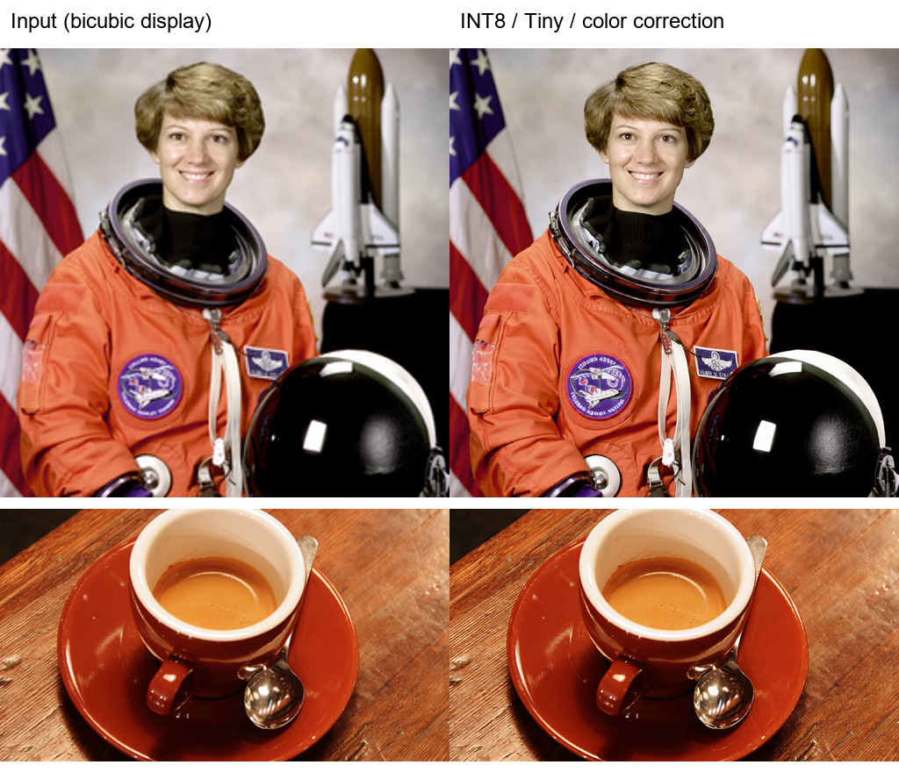

# 单图验收 / Single-image acceptance

## 中文

现有 **Upscale Frames** 可直接处理单张 RGB 图片。本次使用真实权重、真实 ComfyUI 的 `LoadImage → Upscale Frames → SaveImage` 路径测试，无视频转码；共完成 **10 次 GPU 推理**：三个样本各测 BF16 / INT8，再测三次 INT8 颜色校正，最后重放保存的工作流。

| 样本 | 输入 → 输出 | 目视验收 |
| --- | --- | --- |
| 人像 | 256×256 → 1024×1024 | 主体、姿态、衣服和背景结构完整，无黑图、网格或接缝；皮肤更平滑，发丝和徽章小字有重建 |
| 咖啡与木纹 | 480×270 → 1920×1080 | 杯口、盘沿和勺子几何完整，木纹增强；未发现严重结构伪影 |
| 文字、色块与细线 | 256×192 → 1024×768 | 功能通过，严格保真未通过：小字笔画变化，色块内有纹理及轻微边缘晕圈 |

主 Agent 与独立子 Agent 均实际查看了输入、参考和输出。照片增强在这两个样本上通过；不能据此承诺所有图片保真。BF16 与 INT8 的三组输出 SSIM 为 **0.9933–0.9965**，观感相近；这是两种精度之间的比较，不是对原图画质的评分。

专用工作流默认启用 **color_correction**，实测可减轻整体颜色与饱和度变化；它不能恢复原始小字或保证平色色块一致。需原样保留文字、图表、标志时，不应把生成式增强当作保真放大。人像参考仅 512×512，咖啡参考仅 600×338，均不是输出分辨率的高分辨率真值。

使用方法：

1. 将 [示例图片](../example_workflows/flashvsr_plus_sample.png) 复制到 `ComfyUI/input`。
2. 导入 [UI 工作流](../example_workflows/FlashVSR_Plus_Single_Image.json)，或拖入 [实测人像 PNG](../assets/single_image/portrait.png) 恢复其内嵌工作流。也提供 [API JSON](../example_workflows/FlashVSR_Plus_Single_Image_API.json)。
3. 保持默认设置运行，或在 Load Image 中选择自己的静态图片。结果保存在 `ComfyUI/output/FlashVSRPlus`。

默认 `turbo / int8_convrot / tiny / attention=auto`，4×、宽高为 0、seed 1 固定、颜色校正开启。保存后的 UI 与 API 参数已双向核对并实际重放，输出与先前颜色校正测试逐像素一致；PNG 同时保留 prompt 和 UI workflow。

当前 IMAGE batch 被解释为连续时间帧，多张无关图片请逐张处理。节点仅处理 RGB，不自动合成透明 MASK。单张图片仍有视频模型的最小计算块开销。此次没有进行 4K 测试。

## English

The existing **Upscale Frames** node accepts one RGB image directly. Acceptance used real checkpoints and the real ComfyUI `LoadImage → Upscale Frames → SaveImage` path, with no video encoding. **Ten GPU runs** covered three samples in BF16 and INT8, three additional INT8 color-correction checks, and one replay of the saved workflow.

The portrait (256² → 1024²) and coffee photo (480×270 → 1920×1080) passed sample-limited photo enhancement review: composition and main geometry were retained, without black output, grids, or seams. Skin was smoother and fine textures were reconstructed. The text chart (256×192 → 1024×768) passed execution but **failed strict fidelity**: small glyphs changed, flat fields gained texture, and faint edge halos appeared.

Both the primary and independent agents inspected actual inputs, references, and outputs. Corresponding BF16 / INT8 results had SSIM **0.9933–0.9965** and similar overall appearance. This compares the two precisions, not fidelity to the original scene. Color correction improved overall color on these samples; it did not restore exact text or flat fields. Photo references were only 512² and 600×338, rather than ground truth at the output resolutions.

Copy the [sample](../example_workflows/flashvsr_plus_sample.png) to `ComfyUI/input`, then import the [UI workflow](../example_workflows/FlashVSR_Plus_Single_Image.json) or drag in the [output PNG with its embedded workflow](../assets/single_image/portrait.png). An [API example](../example_workflows/FlashVSR_Plus_Single_Image_API.json) is also included. Select another static PNG/JPEG in Load Image as needed. Outputs are saved under `ComfyUI/output/FlashVSRPlus`.

Defaults are `turbo / int8_convrot / tiny / attention=auto`, 4×, width/height 0, fixed seed 1, and color correction enabled. The UI/API parameters were independently cross-checked and replayed on GPU; output pixels matched the earlier color-corrected test exactly. The saved PNG embeds both the prompt and UI workflow.

Unrelated images must be processed individually: an IMAGE batch is treated as consecutive video frames. Alpha requires separate handling. Single images retain the video's minimum processing-block cost. No 4K testing was performed in this acceptance.

## 实测文件 / Evidence

左列为输入的双三次显示放大，右列为 INT8 + Tiny + 颜色校正结果；此处为缩略预览。 / Left: input enlarged for display with bicubic interpolation. Right: INT8 + Tiny with color correction. These are previews.

- [人像 / Portrait, 1024×1024 PNG](../assets/single_image/portrait.png)
- [咖啡 / Coffee, 1920×1080 PNG](../assets/single_image/coffee_1080p.png) · [输入 / Input](../assets/single_image/coffee_1080p_input.png)
- [文字保真局限 / Text-fidelity comparison](../assets/single_image/text_comparison.jpg) · [输出 / Output](../assets/single_image/text_limit.png) · [输入 / Input](../assets/single_image/text_limit_input.png)
- [结构化记录、工作流及文件 SHA-256 / Run records and SHA-256](SINGLE_IMAGE_VALIDATION.json)

配置 / Configuration: RTX 5090 Laptop 24 GB, Windows, ComfyUI 0.41.0, PyTorch 2.7.0+cu128, triton-windows 3.3.1.post21, Turbo, Tiny, temporal compression 4. Individual client timings ranged from 8.1 to 30.3 seconds, including loading and first-run compilation; they are not an isolated performance benchmark. 样张来源与许可见 / Sample attribution: [NOTICE](../NOTICE).
